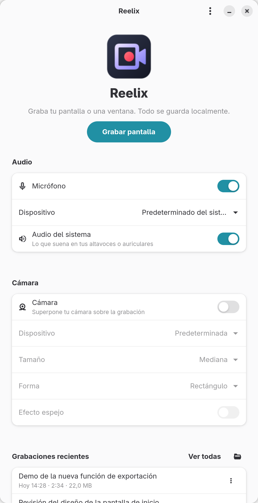
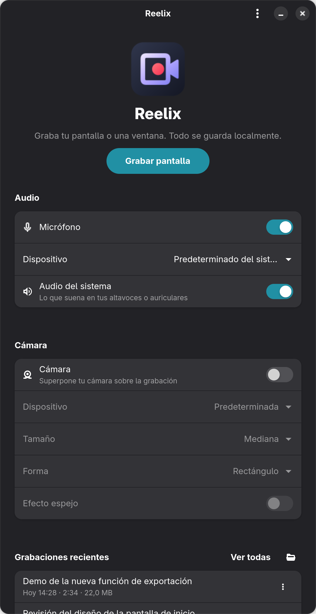
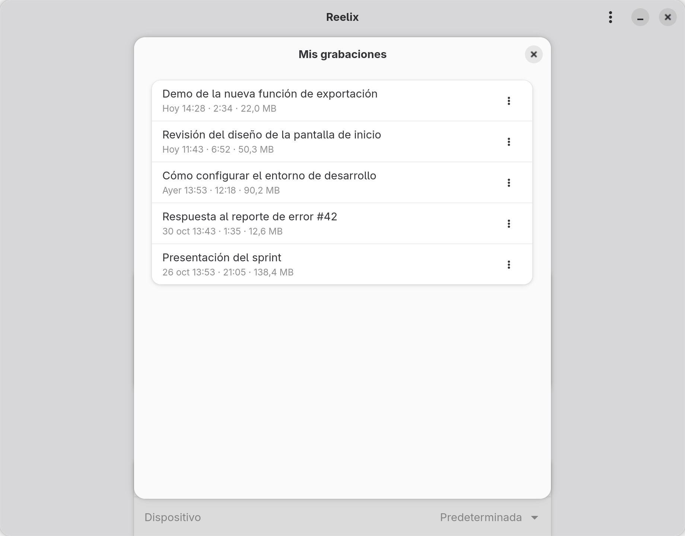
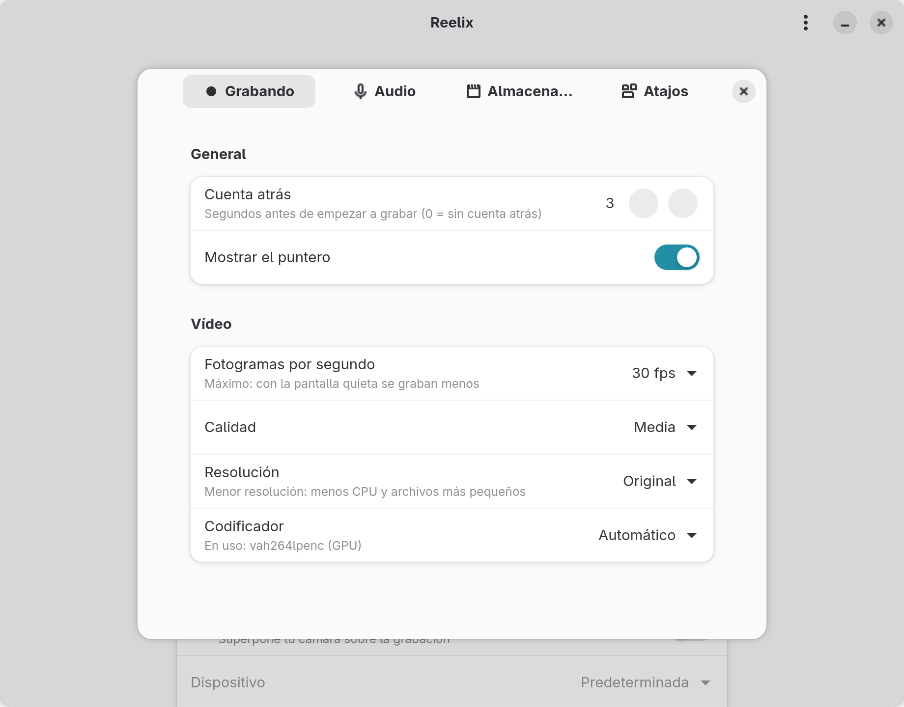

<div align="center">


# Reelix

**Graba tu pantalla, tu voz y tu cara. Sin nube, sin cuentas, sin esfuerzo.**

Grabador de pantalla nativo para GNOME y Wayland, al estilo de Loom.

[](https://github.com/oscar503sv/reelix/releases/latest)
[](LICENSE)
[](https://www.gnome.org)
[](https://wayland.freedesktop.org)
[](https://www.rust-lang.org)

[English](README.md) · **Español**

&nbsp;&nbsp;

</div>

---

## ✨ Por qué Reelix

| | |
|---|---|
| 🔒 **100 % local** | Sin cuentas, sin nube, sin telemetría. Tus vídeos nunca salen de tu equipo. |
| 🫧 **Burbuja de cámara** | Tu cámara en una burbuja flotante (círculo o rectángulo) con borde "camaleón". Arrástrala a donde quieras. |
| 🎙️ **Voz + audio del sistema** | Micrófono y lo que suena en tus altavoces, mezclados con limitador para que nada sature. |
| 🪶 **Ligero** | Codificación y color en la GPU: ~3 % de CPU grabando, ~6 % con la burbuja, 0,1 % en reposo. |
| 🧩 **Nativo de verdad** | GTK4/libadwaita, portales XDG y PipeWire. Sin X11 ni trucos. |
| 🛟 **A prueba de cierres** | Si algo falla, el MP4 se puede reproducir hasta el último segundo. |

## 📥 Descargar

Paquetes en la [última release](https://github.com/oscar503sv/reelix/releases/latest):

**Flatpak** (cualquier distribución con Flathub configurado):

```bash
flatpak install --user ./reelix-0.7.1.flatpak
flatpak run io.github.oscar503sv.Reelix
```

**RPM** (Fedora 44):

```bash
sudo dnf install ./reelix-0.7.1-1.fc44.x86_64.rpm
```

> No instales a la vez el RPM y el Flatpak: comparten ID y GNOME mostraría solo uno.

## 🎬 Qué hace

- Botón **Grabar pantalla** → selector nativo de GNOME (pantalla o ventana).
- Graba a `~/Vídeos/Reelix/recording-AAAA-MM-DD-HHMMSS.mp4` (H.264 + AAC)
  más un `.json` con metadatos (título, fecha, duración, resolución, fps,
  audio, encoder).
- **Micrófono** (predeterminado o uno concreto) y **audio del sistema**, por
  separado o mezclados, con medidor de nivel en vivo. Al mezclar, el audio del
  sistema baja al 60 % para que la voz se entienda, y un limitador evita la
  saturación.
- **Burbuja de cámara en pantalla**: ventana flotante con tu cámara en vivo
  (círculo o rectángulo redondeado, tres tamaños, efecto espejo, borde
  "camaleón" que cambia de color) que puedes arrastrar. Al grabar la pantalla
  completa se graba tal cual se ve; al grabar una sola ventana, la cámara se
  compone dentro del vídeo en la esquina elegida.
- Durante la grabación la ventana principal se minimiza y la burbuja muestra
  **● REC + tiempo**, **Pausar/Reanudar** y **Detener** al pasar el ratón.
- **Pausa** sin huecos en el archivo y **cuenta atrás** configurable (no
  aparece en el vídeo; Esc la cancela).
- **Mis grabaciones**: reproducir, renombrar, mostrar en la carpeta, copiar
  el archivo al portapapeles, ver detalles y mover a la papelera.
- **Preferencias**: cuenta atrás, fps, calidad, resolución máxima (720p para
  equipos modestos), codificador (muestra el que se usa), puntero, volumen
  del micrófono, carpeta y atajos.
- **Atajos globales** opcionales (portal GlobalShortcuts): funcionan sin que
  Reelix tenga el foco.
- Detener desde el indicador "compartiendo pantalla" de GNOME también
  finaliza el archivo correctamente.
- Evita que la sesión se suspenda mientras graba.
- Se graba en MP4 fragmentado y al terminar se convierte, sin recodificar, en
  un MP4 normal con el índice al principio.

<div align="center">
&nbsp;&nbsp;
</div>

## 🧰 Requisitos

Fedora 40+ con GNOME en sesión Wayland (probado en Fedora 44, GNOME 50.6,
GStreamer 1.28, PipeWire 1.6). El Flatpak funciona en cualquier distribución
con Wayland y portales.

Ejecución (en Fedora Workstation casi todo viene preinstalado):

```bash
sudo dnf install pipewire-gstreamer pipewire-pulseaudio gstreamer1-plugins-good \
    gstreamer1-plugins-bad-free gstreamer1-plugin-gtk4 gstreamer1-plugin-openh264 \
    xdg-desktop-portal xdg-desktop-portal-gnome
```

Compilación (además de lo anterior):

```bash
sudo dnf install rust cargo gcc gtk4-devel libadwaita-devel \
    gstreamer1-devel gstreamer1-plugins-base-devel
```

### ⚡ Aceleración por hardware (Intel, opcional)

El `libva-intel-media-driver` de Fedora **no incluye codificación H.264**
(por patentes). Sin él, Reelix usa `openh264enc` (software, ~60 % de un
núcleo a 1080p30). Con la versión de RPM Fusion, la GPU codifica **y**
convierte el color (`vah264lpenc` + `vapostproc`) y grabar cuesta ~3 % de
CPU. Desde una terminal (`pkexec` en lugar de `sudo` muestra el diálogo
gráfico de contraseña):

```bash
# intel-media-driver está en RPM Fusion *nonfree* (no en free)
sudo dnf install https://mirrors.rpmfusion.org/nonfree/fedora/rpmfusion-nonfree-release-$(rpm -E %fedora).noarch.rpm
sudo dnf swap libva-intel-media-driver intel-media-driver --allowerasing
rm -rf ~/.cache/gstreamer-1.0    # que GStreamer vuelva a detectar los encoders
vainfo | grep -i "H264.*Enc"     # debe listar VAEntrypointEncSliceLP
gst-inspect-1.0 vah264lpenc      # debe existir
# Volver atrás: sudo dnf swap intel-media-driver libva-intel-media-driver --allowerasing
```

Reelix detecta el encoder en tiempo de ejecución; no hay que recompilar. El
Flatpak trae su propio driver VA-API de Intel (extensión del runtime).

## 🛠️ Desde el código

```bash
git clone https://github.com/oscar503sv/reelix && cd reelix
cargo build --release
./target/release/reelix
```

CLI:

```bash
reelix              # abre la ventana
reelix --record     # abre la ventana y lanza el selector directamente
reelix --list       # lista las grabaciones y sale
reelix --version
RUST_LOG=debug reelix   # logs detallados
```

Construir los paquetes: `packaging/rpm/build-rpm.sh` y
`packaging/flatpak/build-flatpak.sh` (ver
[DEVELOPMENT.md](DEVELOPMENT.md#empaquetado)). Instalación local del
lanzador e íconos: [DEVELOPMENT.md](DEVELOPMENT.md#instalación-local).

## ⌨️ Atajos

| Atajo | Acción |
|---|---|
| Ctrl+Mayús+R | Empezar/detener grabación |
| Ctrl+Mayús+P | Pausar/reanudar |
| Ctrl+, | Preferencias |
| Esc | Cancelar (descarta la grabación) |
| Ctrl+Q | Salir |

Por defecto funcionan con la ventana de Reelix enfocada. En *Preferencias →
Atajos* puedes activar los **atajos globales**: GNOME pide confirmarlos y
desde entonces Ctrl+Mayús+R/P funcionan en todo el sistema.

## 🔐 Wayland, PipeWire y permisos

En Wayland ninguna aplicación puede leer la pantalla directamente. Reelix
pide la captura a **xdg-desktop-portal** (`org.freedesktop.portal.ScreenCast`);
GNOME muestra su propio diálogo y, si aceptas, entrega un descriptor de
PipeWire limitado a la pantalla o ventana elegida. Por eso:

- El diálogo de GNOME aparece en cada grabación.
- Mientras graba, GNOME muestra un indicador en la barra superior; pulsarlo
  detiene la grabación.
- La cámara también pasa por su portal (Configuración → Privacidad → Cámara).
- Reelix nunca se ejecuta como root (se niega a hacerlo) y no necesita
  permisos especiales. El Flatpak solo pide Wayland, GPU, audio y la carpeta
  Vídeos.

## ⚙️ Configuración

`~/.config/reelix/settings.toml` (en Flatpak:
`~/.var/app/io.github.oscar503sv.Reelix/config/reelix/settings.toml`).
Opcional; todo tiene valores por defecto y se edita desde Preferencias:

```toml
[recording]
countdown_seconds = 3    # 0–10

[video]
fps = 30                 # 5–60, límite superior (la salida es VFR)
quality = "medium"       # low | medium | high
resolution = "original"  # original | 1080p | 720p
encoder = "auto"         # auto | hardware | software
show_cursor = true

[audio]
microphone = true
# microphone_device = "alsa_input.…"   # node.name; ver `wpctl status`
microphone_volume = 1.0  # 0.0–4.0
system_audio = false

[camera]
enabled = false
# device = "v4l2_input.…"  # node.name
size = "medium"          # small | medium | large
shape = "rectangle"      # rectangle | circle
corner = "bottom-right"  # al grabar una ventana: top-left | top-right | bottom-left | bottom-right
mirror = false

[shortcuts]
global = false

[storage]
# recording_dir = "/home/usuario/Vídeos/Reelix"
```

## 🩺 Solución de problemas

| Síntoma | Causa / solución |
|---|---|
| "No se pudo acceder a la pantalla" | Comprueba que la sesión es Wayland (`echo $XDG_SESSION_TYPE`) y que `xdg-desktop-portal-gnome` está instalado. `systemctl --user restart xdg-desktop-portal`. |
| "Faltan componentes multimedia" | Falta `pipewire-gstreamer` (`gst-inspect-1.0 pipewiresrc`), `gstreamer1-plugin-gtk4` u otro plugin. |
| "No hay codificador de vídeo disponible" | `sudo dnf install gstreamer1-plugin-openh264`. |
| CPU alta al grabar | Codificación por software: instala `intel-media-driver` de RPM Fusion **nonfree** (ver arriba) o baja la resolución a 720p. En el log: `encoder=openh264enc` (software) o `vah264lpenc` (GPU). |
| `dnf` no encuentra `intel-media-driver` | Está en RPM Fusion *nonfree*, no en *free*. |
| Aviso "No se encontró ningún micrófono" | Revisa Configuración → Sonido → Entrada y `wpctl status`. La grabación continúa sin micrófono. |
| La barra de nivel no se mueve | El micrófono está silenciado o con volumen 0, o se eligió otro dispositivo. |
| La burbuja tiene un cuadrado oscuro o difuminado alrededor | Lo pinta algo externo: (1) un tema GTK con `window { background-color: … }` en `~/.config/gtk-4.0/gtk.css` (Reelix ya lo anula para la burbuja); (2) **Blur my Shell**: añade `io.github.oscar503sv.Reelix` a *Applications → Blacklist*. |
| La burbuja no se queda encima o no sigue al cambiar de escritorio | Wayland no deja que la app lo decida: con el ratón sobre la burbuja, Alt+Espacio → «Siempre encima» y «Siempre en el área de trabajo visible». |
| Aviso "No hay cámara disponible" | Comprueba que la cámara aparece en `wpctl status` (sección Video) y que no la usa otra app. |
| Acceso a la cámara denegado | Configuración → Privacidad → Cámara. |
| El audio del sistema no se graba | Necesita `pipewire-pulseaudio`: `pactl info` debe responder. |
| Log con `stream error: target not found` al parar | Normal: el portal cerró el stream después de finalizar el archivo. |

Para depurar: `RUST_LOG=reelix=debug GST_DEBUG=pipewiresrc:4,pulsesrc:4,mp4mux:4 reelix`.

## 🏗️ Arquitectura

```
GTK4/libadwaita (UI) → Controller + máquina de estados → Portal ScreenCast (ashpd)
   → PipeWire (DMA-BUF) → GStreamer: pipewiresrc → vapostproc/videoconvert → H.264 ─┐
   micrófono / monitor del sistema → pulsesrc → audiomixer → limitador → AAC ────────┴→ mp4mux → archivo
   burbuja: portal Camera → pipewiresrc → vapostproc → DMA-BUF → GTK (recorte, espejo y borde en la GPU)
```

Detalles, decisiones y mediciones en [ARCHITECTURE.md](ARCHITECTURE.md).
Guía de desarrollo en [DEVELOPMENT.md](DEVELOPMENT.md) y cómo colaborar en
[CONTRIBUTING.es.md](CONTRIBUTING.es.md).

## 🌍 Traducciones

La interfaz está en **inglés** y **español** y sigue el idioma del sistema.

| Idioma | Estado |
|---|---|
| Inglés | idioma original |
| Español (`es`) | completo |

Añadir un idioma es un solo archivo, `po/<código>.po`, enviado como pull
request. La [guía de traducción](CONTRIBUTING.es.md#traducciones) explica
cómo.

## 🗺️ Hoja de ruta


- [x] **Fase 1**: GUI → portal → PipeWire → GStreamer → MP4.
- [x] **Fase 2**: micrófono y audio del sistema (PipeWire) + AAC en el mismo MP4.
- [x] **Fase 3**: cámara (portal Camera) + composición en el pipeline.
- [x] **Fase 4**: burbuja, pausa, cuenta atrás, biblioteca, preferencias, atajos globales.
- [x] **Fase 5**: medición y optimización: sin relleno en los MP4, codificación y color en la GPU.
- [x] **Fase 6**: bajo consumo: burbuja en la GPU (19 % → 6 % de CPU) y resolución máxima.
- [x] **Fase 7**: paquetes RPM y Flatpak, ícono definitivo, capturas y release 0.7.0.
- [ ] Flathub y COPR.
- [x] Interfaz en inglés y español, abierta a más idiomas (0.8.0).

- [ ] Recordar la pantalla elegida (*restore tokens* del portal).

## 🎨 Identidad visual

Ícono oficial y variantes (claro, acento, simbólico) en [`branding/`](branding/).

## 📄 Licencia

MIT. Ver [LICENSE](LICENSE).
