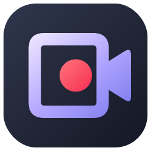
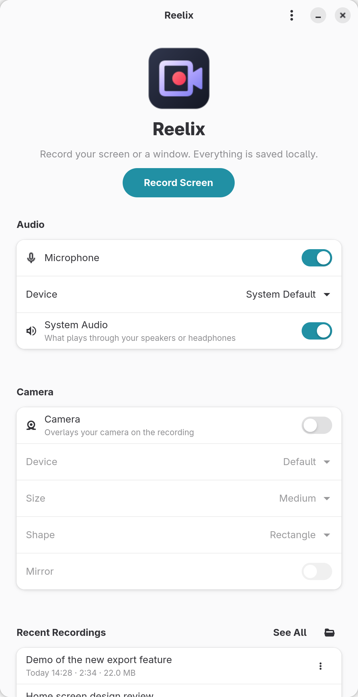
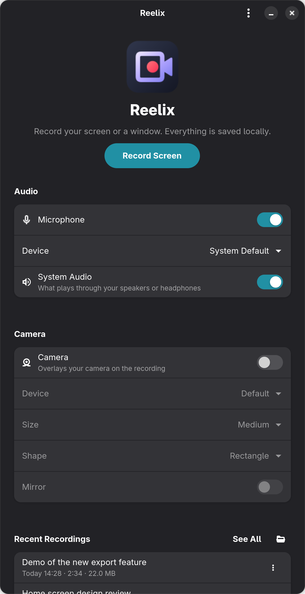
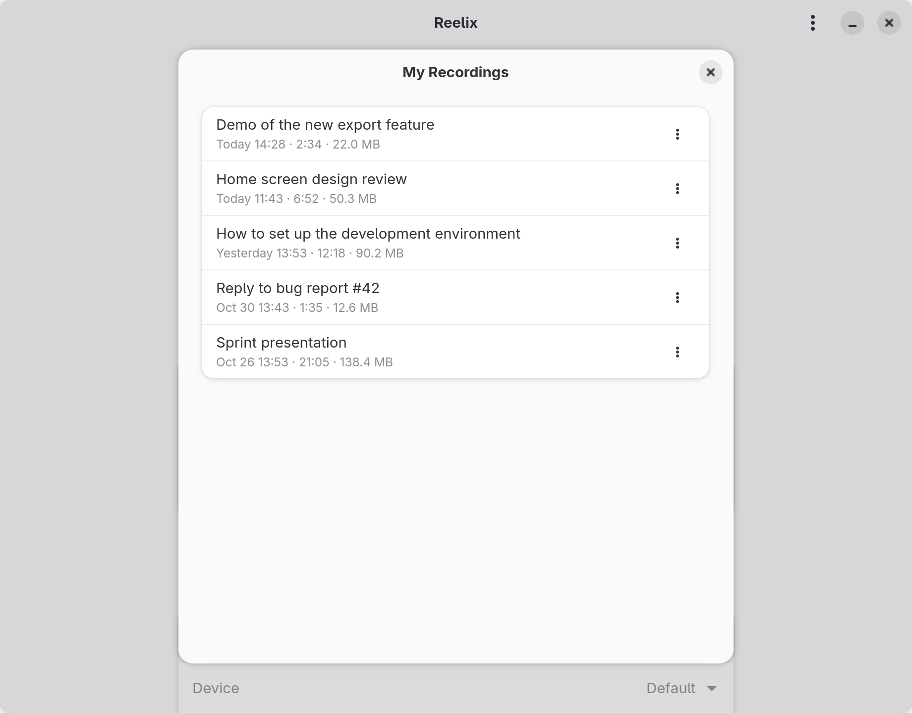
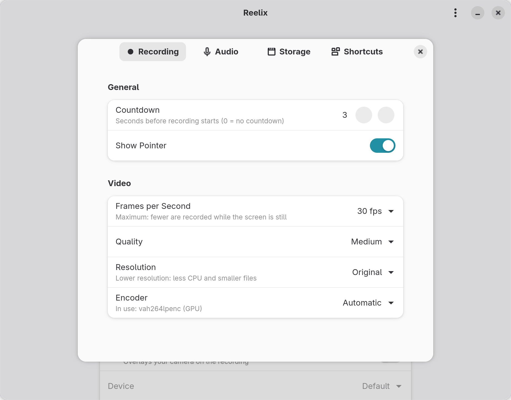

<div align="center">



# Reelix

**Record your screen, your voice and your face. No cloud, no accounts, no hassle.**

A native, Loom-style screen recorder for GNOME and Wayland.

[](https://github.com/oscar503sv/reelix/releases/latest)
[](LICENSE)
[](https://www.gnome.org)
[](https://wayland.freedesktop.org)
[](https://www.rust-lang.org)

**English** · [Español](README.es.md)

&nbsp;&nbsp;

</div>

> The interface is available in **English** and **Spanish**, and follows
> your system language. Want Reelix in your language? Translations are
> welcome: see the [translation guide](CONTRIBUTING.md#translations).

---

## ✨ Why Reelix

| | |
|---|---|
| 🔒 **100 % local** | No accounts, no cloud, no telemetry. Your videos never leave your computer. |
| 🫧 **Camera bubble** | Your webcam in a floating bubble (circle or rectangle) with a colour-shifting "chameleon" border. Drag it anywhere. |
| 🎙️ **Voice + system audio** | Microphone and whatever plays on your speakers, mixed with a limiter so nothing clips. |
| 🪶 **Lightweight** | Encoding and colour conversion on the GPU: ~3 % CPU while recording, ~6 % with the bubble, 0.1 % idle. |
| 🧩 **Truly native** | GTK4/libadwaita, XDG portals and PipeWire. No X11, no hacks. |
| 🛟 **Crash-proof** | If anything goes wrong, the MP4 still plays up to the last second. |

## 📥 Download

Packages are attached to the [latest release](https://github.com/oscar503sv/reelix/releases/latest):

**Flatpak** (any distribution with Flathub set up):

```bash
flatpak install --user ./reelix-0.7.1.flatpak
flatpak run io.github.oscar503sv.Reelix
```

**RPM** (Fedora 44):

```bash
sudo dnf install ./reelix-0.7.1-1.fc44.x86_64.rpm
```

> Don't install the RPM and the Flatpak at the same time: they share an app
> ID and GNOME would only show one of them.

## 🎬 Features

- **Record screen** button → GNOME's native picker (whole screen or a window).
- Saves to `~/Videos/Reelix/recording-YYYY-MM-DD-HHMMSS.mp4` (H.264 + AAC)
  plus a `.json` with metadata (title, date, duration, resolution, fps,
  audio, encoder).
- **Microphone** (default or a specific one) and **system audio**, separately
  or mixed, with a live level meter. When mixing, system audio is lowered to
  60 % so your voice stays clear, and a limiter prevents clipping.
- **On-screen camera bubble**: a floating window with your live webcam
  (circle or rounded rectangle, three sizes, mirror effect, colour-shifting
  "chameleon" border) that you can drag around. Full-screen recordings
  capture it exactly as you see it; single-window recordings composite the
  camera into the video in the corner you choose.
- While recording, the main window minimizes and the bubble shows
  **● REC + time**, **Pause/Resume** and **Stop** on hover.
- Gap-free **pause** and a configurable **countdown** (never recorded; Esc
  cancels it).
- **My recordings**: play, rename, show in folder, copy the file to the
  clipboard, see details and move to trash.
- **Preferences**: countdown, fps, quality, maximum resolution (720p for
  modest machines), encoder (shows the one in use), pointer, microphone
  volume, folder and shortcuts.
- Optional **global shortcuts** (GlobalShortcuts portal): they work even when
  Reelix isn't focused.
- Stopping from GNOME's "screen sharing" indicator also finalizes the file
  properly.
- Prevents the session from suspending while recording.
- Records fragmented MP4 and, when done, turns it into a regular MP4 with the
  index at the start, without re-encoding.

<div align="center">
&nbsp;&nbsp;
</div>

## 🧰 Requirements

Fedora 40+ with GNOME on Wayland (tested on Fedora 44, GNOME 50.6,
GStreamer 1.28, PipeWire 1.6). The Flatpak runs on any distribution with
Wayland and portals.

Runtime (mostly preinstalled on Fedora Workstation):

```bash
sudo dnf install pipewire-gstreamer pipewire-pulseaudio gstreamer1-plugins-good \
    gstreamer1-plugins-bad-free gstreamer1-plugin-gtk4 gstreamer1-plugin-openh264 \
    xdg-desktop-portal xdg-desktop-portal-gnome
```

Building (in addition to the above):

```bash
sudo dnf install rust cargo gcc gtk4-devel libadwaita-devel \
    gstreamer1-devel gstreamer1-plugins-base-devel
```

### ⚡ Hardware acceleration (Intel, optional)

Fedora's `libva-intel-media-driver` **does not include H.264 encoding**
(patents). Without it, Reelix uses `openh264enc` (software, ~60 % of a core
at 1080p30). With the RPM Fusion build, the GPU encodes **and** converts
colour (`vah264lpenc` + `vapostproc`), and recording costs ~3 % CPU. From a
terminal (`pkexec` instead of `sudo` shows the graphical password dialog):

```bash
# intel-media-driver lives in RPM Fusion *nonfree* (not free)
sudo dnf install https://mirrors.rpmfusion.org/nonfree/fedora/rpmfusion-nonfree-release-$(rpm -E %fedora).noarch.rpm
sudo dnf swap libva-intel-media-driver intel-media-driver --allowerasing
rm -rf ~/.cache/gstreamer-1.0    # make GStreamer rescan the encoders
vainfo | grep -i "H264.*Enc"     # should list VAEntrypointEncSliceLP
gst-inspect-1.0 vah264lpenc      # should exist
# Undo: sudo dnf swap intel-media-driver libva-intel-media-driver --allowerasing
```

Reelix picks the encoder at runtime; no rebuild needed. The Flatpak ships
its own Intel VA-API driver (runtime extension).

## 🛠️ Building from source

```bash
git clone https://github.com/oscar503sv/reelix && cd reelix
cargo build --release
./target/release/reelix
```

CLI:

```bash
reelix              # open the window
reelix --record     # open the window and go straight to the picker
reelix --list       # list recordings and exit
reelix --version
RUST_LOG=debug reelix   # verbose logs
```

Building the packages: `packaging/rpm/build-rpm.sh` and
`packaging/flatpak/build-flatpak.sh` (see
[DEVELOPMENT.md](DEVELOPMENT.md#empaquetado), in Spanish). Installing the
launcher and icons locally: [DEVELOPMENT.md](DEVELOPMENT.md#instalación-local).

## ⌨️ Shortcuts

| Shortcut | Action |
|---|---|
| Ctrl+Shift+R | Start/stop recording |
| Ctrl+Shift+P | Pause/resume |
| Ctrl+, | Preferences |
| Esc | Cancel (discards the recording) |
| Ctrl+Q | Quit |

By default they work while Reelix is focused. Enable **global shortcuts** in
*Preferences → Shortcuts*: GNOME asks you to confirm them, and from then on
Ctrl+Shift+R/P work system-wide.

## 🔐 Wayland, PipeWire and permissions

On Wayland no application can read the screen directly. Reelix asks
**xdg-desktop-portal** (`org.freedesktop.portal.ScreenCast`); GNOME shows
its own dialog and, if you accept, hands over a PipeWire stream limited to
the screen or window you picked. That's why:

- GNOME's dialog appears for every recording.
- While recording, GNOME shows an indicator in the top bar; clicking it stops
  the recording.
- The camera goes through its own portal too (Settings → Privacy → Camera).
- Reelix never runs as root (it refuses to) and needs no special permissions.
  The Flatpak only asks for Wayland, GPU, audio and the Videos folder.

## ⚙️ Configuration

`~/.config/reelix/settings.toml` (Flatpak:
`~/.var/app/io.github.oscar503sv.Reelix/config/reelix/settings.toml`).
Optional; everything has defaults and is editable from Preferences:

```toml
[recording]
countdown_seconds = 3    # 0–10

[video]
fps = 30                 # 5–60, upper bound (output is variable frame rate)
quality = "medium"       # low | medium | high
resolution = "original"  # original | 1080p | 720p
encoder = "auto"         # auto | hardware | software
show_cursor = true

[audio]
microphone = true
# microphone_device = "alsa_input.…"   # node.name; see `wpctl status`
microphone_volume = 1.0  # 0.0–4.0
system_audio = false

[camera]
enabled = false
# device = "v4l2_input.…"  # node.name
size = "medium"          # small | medium | large
shape = "rectangle"      # rectangle | circle
corner = "bottom-right"  # for window recordings: top-left | top-right | bottom-left | bottom-right
mirror = false

[shortcuts]
global = false

[storage]
# recording_dir = "/home/user/Videos/Reelix"
```

## 🩺 Troubleshooting

| Symptom | Cause / fix |
|---|---|
| "Could not access the screen" | Make sure the session is Wayland (`echo $XDG_SESSION_TYPE`) and `xdg-desktop-portal-gnome` is installed. `systemctl --user restart xdg-desktop-portal`. |
| "Missing multimedia components" | `pipewire-gstreamer` (`gst-inspect-1.0 pipewiresrc`), `gstreamer1-plugin-gtk4` or another plugin is missing. |
| "No video encoder available" | `sudo dnf install gstreamer1-plugin-openh264`. |
| High CPU while recording | Software encoding: install `intel-media-driver` from RPM Fusion **nonfree** (see above) or lower the resolution to 720p. The log says `encoder=openh264enc` (software) or `vah264lpenc` (GPU). |
| `dnf` can't find `intel-media-driver` | It's in RPM Fusion *nonfree*, not *free*. |
| "No microphone found" warning | Check Settings → Sound → Input and `wpctl status`. Recording continues without a microphone. |
| The level meter doesn't move | The microphone is muted or at volume 0, or another device is selected. |
| A dark or blurred square around the bubble | Something outside Reelix paints it: (1) a GTK theme with `window { background-color: … }` in `~/.config/gtk-4.0/gtk.css` (Reelix already overrides it for the bubble); (2) **Blur my Shell**: add `io.github.oscar503sv.Reelix` to *Applications → Blacklist*. |
| The bubble doesn't stay on top or follow workspaces | Wayland doesn't let apps decide: hover the bubble, press Alt+Space → "Always on Top" and "Always on Visible Workspace". |
| "No camera available" warning | Check that the camera shows up in `wpctl status` (Video section) and isn't used by another app. |
| Camera access denied | Settings → Privacy → Camera. |
| System audio isn't recorded | Needs `pipewire-pulseaudio`: `pactl info` must answer. |
| `stream error: target not found` in the log when stopping | Harmless: the portal closed the stream after the file was finalized. |

Debugging: `RUST_LOG=reelix=debug GST_DEBUG=pipewiresrc:4,pulsesrc:4,mp4mux:4 reelix`.

## 🏗️ Architecture

```
GTK4/libadwaita (UI) → Controller + state machine → ScreenCast portal (ashpd)
   → PipeWire (DMA-BUF) → GStreamer: pipewiresrc → vapostproc/videoconvert → H.264 ─┐
   microphone / system monitor → pulsesrc → audiomixer → limiter → AAC ──────────────┴→ mp4mux → file
   bubble: Camera portal → pipewiresrc → vapostproc → DMA-BUF → GTK (crop, mirror and border on the GPU)
```

Design decisions and measurements in [ARCHITECTURE.md](ARCHITECTURE.md),
development guide in [DEVELOPMENT.md](DEVELOPMENT.md) and how to contribute
in [CONTRIBUTING.md](CONTRIBUTING.md).

## 🌍 Translations

| Language | Status |
|---|---|
| English | source language |
| Spanish (`es`) | complete |

Adding a language takes one file, `po/<code>.po`, sent as a pull request.
The [translation guide](CONTRIBUTING.md#translations) walks you through it.

## 🗺️ Roadmap

- [x] **Phase 1**: GUI → portal → PipeWire → GStreamer → MP4.
- [x] **Phase 2**: microphone and system audio (PipeWire) + AAC in the same MP4.
- [x] **Phase 3**: camera (Camera portal) + compositing in the pipeline.
- [x] **Phase 4**: bubble, pause, countdown, library, preferences, global shortcuts.
- [x] **Phase 5**: measurement and optimization: no MP4 padding, GPU encoding and colour conversion.
- [x] **Phase 6**: low resource usage: GPU bubble (19 % → 6 % CPU) and maximum resolution.
- [x] **Phase 7**: RPM and Flatpak packages, final icon, screenshots and the 0.7.0 release.
- [ ] Flathub and COPR.
- [x] Interface in English and Spanish, open to more languages (0.8.0).

- [ ] Remember the chosen screen (portal restore tokens).

## 🎨 Branding

Official icon and variants (light, accent, symbolic) in [`branding/`](branding/).

## 📄 License

MIT. See [LICENSE](LICENSE).
